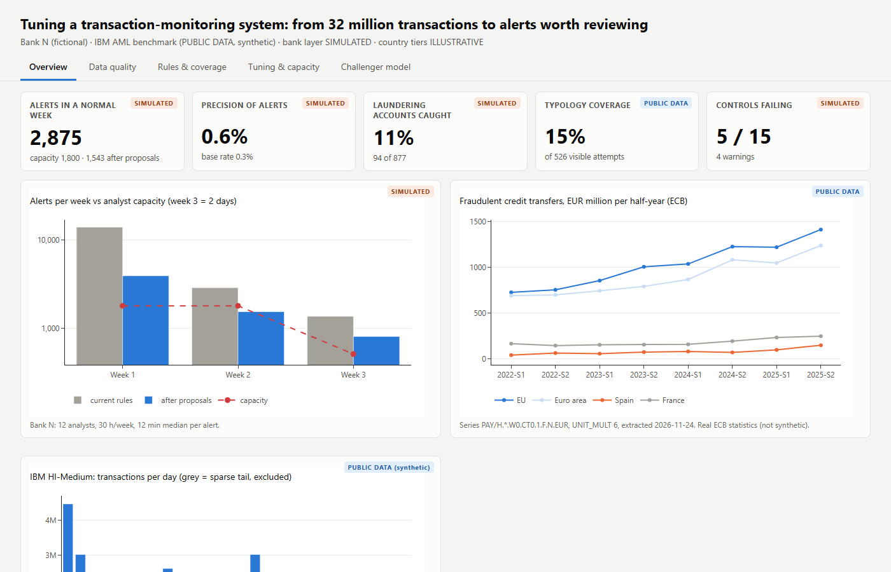

# Tuning a transaction-monitoring system: from 32 million transactions to alerts worth reviewing

**[Read the report (PDF)](https://albt-france.github.io/aml-transaction-monitoring-tuning-case-study/report/aml_tm_assessment.pdf) · [Open the interactive dashboard](https://albt-france.github.io/aml-transaction-monitoring-tuning-case-study/dashboard/)**

<sub>Fallback links in the repository: [site/report/aml_tm_assessment.pdf](site/report/aml_tm_assessment.pdf) · [site/dashboard/index.html](site/dashboard/index.html) (download and open locally)</sub>

An independent case study written as an anti-financial-crime data-analytics engagement. For **Bank N**, a fictional mid-sized
European bank, it asks: does the transaction-monitoring system see the right patterns, on reliable data, with an alert volume
the analysts can handle? And what should change first?

- **Data:** IBM *Transactions for Anti Money Laundering* HI-Medium: 31.9 million transfers, labelled. **PUBLIC DATA (synthetic AML
  benchmark, generated by AMLSim): not real bank transactions.**
- **Bank N layer:** customers, KYC, 12 documented rules and their code, alerts, analyst decisions, capacity, feed metadata. **SIMULATED.**
- **Country risk tiers:** **ILLUSTRATIVE** (drawn at random, not an assessment of any country).

## Key results

1. **Too many alerts for the team.** A normal week produces 2,875 alerts for a capacity of 1,800 (12 analysts), and week 1 produces 13,922.
   Precision is 0.6% against a base rate of 0.3%, and the rules catch 11% of the 877 laundering accounts in the book.
2. **The data and the code are part of the problem.** 5 of 15 automated controls fail. The ACH feed loses the beneficiary bank on 6% of rows
   from 9 Sep. 3 of 12 rules do not do what their documentation says: R04 counts self-transfers, so 90% of its alerts come from a
   day-1 batch, R02 skips currency conversion, and R10 looks back 1 day instead of 7.
3. **Fewer, better alerts.** Code fixes, ATL/BTL threshold tuning and a known-payroll exclusion cut alerts by 65% and raise precision 2.5x.
   A normal week then falls under capacity. A new network scenario (R13: cycles, scatter-gather) finds 14 laundering accounts at 29% precision,
   10 of them missed by the rules. A +50% corporate spike on 14 Sep is shown to be payroll and is **not** escalated.
4. **A challenger score, validated honestly.** A first draft scores AUC 0.99 through leakage. With as-of features and temporal validation,
   the AUC is 0.94. With the threshold set by analyst capacity, the score finds 46% of laundering accounts, against 10% for the tuned rules.
   A Simpson's paradox (SME vs retail precision) shows why precision must be read by risk tier.



## What is in the repository

| Path | Content |
|---|---|
| `src/ingest_dask.py` | Resumable download, Dask CSV to Parquet (partitioned by day), FX to USD, run log (time, memory) |
| `src/simulate_bank_layer.py` | SIMULATED Bank N layer (seed 42): book, KYC, rules (documented vs implemented), payroll batch, feed defect, capacity |
| `src/controls.py`, `controls/controls.yaml` | 15 automated data and KYC controls, PASS / WARN / FAIL report |
| `sql/` | DuckDB: `00_*` feed views; `01_profile` … `10_network_cycles`; `99_tests` (assertions) |
| `src/challenger_model.py` | Gradient-boosting challenger: leaky draft vs temporal validation, capacity threshold, permutation importance, Simpson check |
| `notebooks/aml_tm_assessment.ipynb` | One executed notebook: data, quality, meaning, validation, tuning, network, challenger, recommendations |
| `powerbi/` | **Main BI tool:** Power BI project (PBIP), semantic model in TMDL, 5 report pages in PBIR, data in `powerbi/data/` |
| `site/` | GitHub Pages: landing page, 5-tab Plotly dashboard, 7-page PDF report |
| `docs/` | Engagement documents: scope, data quality, data dictionary, scenario inventory, tuning report, model note, controls catalogue, roadmap, proposal, regulatory context, issues log, assumptions, Power BI measures |
| `data/sim/` | SIMULATED tables (pseudonymous refs only) · `data/public/` ECB and AMLR extracts |

## Methods

- **Pipeline.** Dask reads the 3.0 GB CSV with bank codes and account numbers as text, renames the two columns both called "Account",
  converts amounts with fixed USD rates implied by the file's own cross-currency rows, and writes Parquet partitioned by day.
  The whole file falls in September 2022, so a monthly partition would be a single file. DuckDB runs the SQL layer on the Parquet files.
- **Validation.** Each rule runs twice, as documented and as implemented, on the same data. Alerts are scored against the IBM labels:
  precision, recall on laundering accounts, unique detections. Typology coverage uses the IBM Patterns file.
- **Tuning.** ATL/BTL curves per rule (0.5x to 20x the threshold), counting the laundering accounts lost that no other rule catches.
- **Network scenario.** A recursive SQL search for time-ordered cycles, plus a two-hop scatter-gather search, both bounded in time and amount.
- **Model.** scikit-learn `HistGradientBoostingClassifier`, one row per account and day. As-of features only; trained 1-10 Sep, tested 11-16 Sep;
  threshold set by analyst capacity. KYC risk rating and segment are not features (SIMULATED, partly built from the labels).
- **Privacy.** Entity names are dropped at ingestion. Published outputs use pseudonymous refs (`CUS…`, `ACC_…`, `ENT_…`); no account number
  and no group smaller than 5 accounts is published (`sql/99_tests.sql` checks it).
- AI-assisted workflow: I used Claude, mainly to write scripts faster. I drove the project: I defined the questions, chose and validated the data sources, made the analytical decisions and checked every result.

## How to re-run

Python 3.10+, `pip install -r requirements.txt`. Edge or Chrome is needed only to print the PDF. No API key is needed.

```
python src/ingest_dask.py --size medium      # or --size small (HI-Small, 5M rows) for a quick run
python src/simulate_bank_layer.py
python src/controls.py
python src/run_sql.py
python src/challenger_model.py
python src/fetch_public.py
python src/findings.py
python src/build_docs.py
python src/build_powerbi.py
python src/build_notebook.py
python src/build_dashboard.py
python src/build_pdf.py
```

`controls.py` runs after `simulate_bank_layer.py` because it checks the SIMULATED feed and KYC layer.
The IBM files (3.5 GB) are downloaded once into `data/raw/` and are not stored in the repository.
Power BI: open `powerbi/AmlTmAssessment.pbip` in Power BI Desktop, set the `DataFolder` parameter to the full path of `powerbi/data/`, then refresh.

### Measured time and memory (12-core laptop, 16 GB RAM)
| Step | Time | Peak memory |
|---|---|---|
| Dask ingest, HI-Medium (31.9M rows, 3.0 GB CSV) | 99 s | 4.9 GB |
| Dask ingest, HI-Small (5.1M rows) | 16 s | 3.1 GB |
| DuckDB, same conversion on HI-Small | 2 s | 3.6 GB |
| Simulation, controls, SQL 01-10 and model | about 2.5 min in total | |

Dask is slower than DuckDB on one machine, as expected. It is kept because the same code scales out to a cluster when files no longer fit
on one machine. `src/spark_equivalent.py` reproduces two key aggregations in PySpark (see the note in the file).

## Sources and licences

- IBM, *Transactions for Anti Money Laundering* (Altman et al., "Realistic Synthetic Financial Transactions for Anti-Money Laundering Models",
  NeurIPS 2023 Datasets and Benchmarks), Hugging Face mirror `OsamaMIT/IBM-AML-HI`. Licence **CDLA-Sharing-1.0**. Synthetic data.
- ECB Data Portal, payment statistics (PAY), fraudulent credit transfers, series `PAY/H.<zone>.W0.CT0.1.F.N.EUR`. Real statistics, extracted 24 Nov 2026.
- Regulation (EU) 2024/1624 (AMLR), Publications Office of the EU, CELEX 32024R1624. Articles cited only; **no legal advice**.
  Delegated Regulation (EU) 2016/1675 is cited for context; no country list is derived from it.

## Limits

- 16 days of synthetic data: two full weeks, a 6-day model test. AMLSim laundering is easier to separate than real laundering
  (ACH-heavy), so absolute scores are optimistic. The comparisons are the point.
- Bank N sees both sides of every transfer touching its book; a real bank sees only its own side.
- Planted events (feed defect, documentation gaps, payroll batches) are part of the simulation and are disclosed in `docs/assumptions.md`.
- R13's parameters were checked against the typology file, so its recall is optimistic.

---
Independent case study based on public and synthetic data · not affiliated with any bank or consultancy
